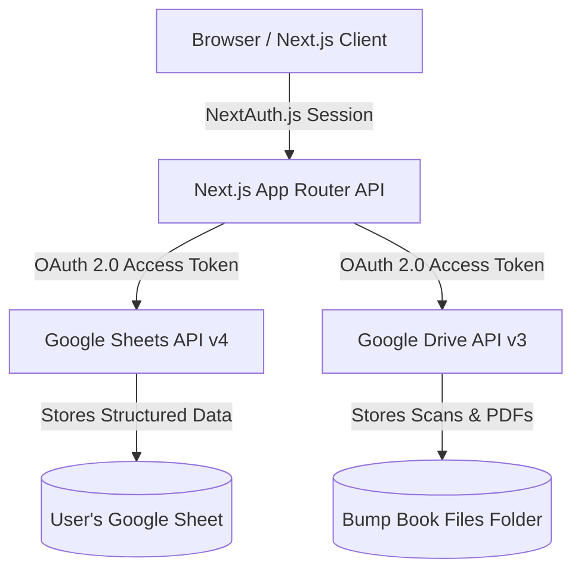

# 📖 Bump Book

> A calm, private, and beautifully designed personal pregnancy journal and health timeline.  
> **100% of your data stays in your own Google Sheet and Google Drive.** No third-party database, no tracking, complete privacy.

---

## 🌟 Why Bump Book?

Expecting a child involves dozens of doctor appointments, lab reports, ultrasound scans, medications, and vitals. Most commercial pregnancy apps store sensitive medical data on private servers, monetize through ads, or fragment information across different tools.

**Bump Book** takes an ownership-first approach:
- **One Pregnancy = One Unified Timeline:** Every consultation, test, medicine, kick count, and ultrasound attached to a date.
- **Your Google Drive is the Database:** The application uses Google Sheets as a structured relational database and Google Drive for document and scan storage.
- **Privacy by Design:** Scoped OAuth access (`drive.file`) ensures the app can only access the files and folders it creates.

---

## ✨ Features

### 📊 Intelligent Dashboard
- **Pregnancy Progress Ring:** Visual tracking of current gestation week, days completed, days remaining, and estimated due date.
- **Trimester Indicator:** Automatic computation of current trimester (T1, T2, T3) and milestone highlights.
- **Quick-Access Actions:** One-tap entry triggers for doctor visits, vitals, kick counts, medicines, and notes.
- **At-a-Glance Summaries:** Active medications, upcoming appointments, and recent health vitals.

### ⏳ Unified Timeline
- Chronological, searchable, and category-filtered feed combining all events:
  - 🩺 **Doctor Visits:** Consultations, symptoms discussed, examination notes, and doctor advice.
  - 💊 **Prescriptions & Medicines:** Dosages, frequencies, active date windows, and prescribing doctors.
  - 🧪 **Lab Tests & Results:** Ordered, pending, and completed diagnostic tests with result summaries.
  - 📁 **Scans & Reports:** Direct links to PDFs and images stored in Google Drive.
  - ❤️ **Maternal Health Vitals:** Blood pressure, weight, blood sugar, hemoglobin, and temperature.
  - 👶 **Baby Growth & Movement:** Estimated weight, fetal heart rate (FHR bpm), and kick counter observations.
  - 🏆 **Milestones:** First positive test, first ultrasound, detecting heartbeat, anatomy scan, baby shower, and delivery.
  - 📝 **Personal Journal & Notes:** Categorized thoughts (General, Symptom, Question, Mood, Diet).

### 📈 Interactive Health & Growth Charts
- Built with Chart.js for smooth, accessible visualizations:
  - **Maternal Weight Trend:** Track weight changes across weeks against healthy gain ranges.
  - **Blood Pressure Tracker:** Systolic & diastolic dual-line chart with normal benchmark reference bands.
  - **Blood Sugar Monitoring:** Fasting / postprandial glucose tracking.
  - **Fetal Growth & Heartbeat (FHR):** Fetal heart rate trends and ultrasound biometric parameters (BPD, FL, AC, HC).
  - **Trimester Filtering:** Easily toggle between Full Pregnancy, 1st Trimester, 2nd Trimester, or 3rd Trimester.

### 📁 Automatic Google Drive Organization
- Uploads ultrasound scans, prescriptions, and lab PDFs directly into a structured hierarchy in your Google Drive:
  ```
  My Drive/
  └── Bump Book Files/
      ├── Reports/
      ├── Ultrasounds/
      ├── Prescriptions/
      └── Other/
  ```

### 🎨 Calm & Accessible Aesthetic
- Built with custom design tokens featuring gentle pastel hues, warm journal typography, dark/light contrast standards, and subtle micro-animations.

---

## 🏗️ Architecture & Storage Model



### Google Sheets Relational Schema
When a user signs in and completes onboarding, a spreadsheet named `Bump Book – <Name>` is created with the following tabs:

| Tab Name | Purpose | Key Columns |
| :--- | :--- | :--- |
| `Overview & Charts` | Live dashboard & embedded charts for sharing | Auto-updating KPIs, maternal weight & BP charts, baby growth trends, and clinical query tables |
| `_Config` | Metadata & app config | `key`, `value` (e.g. Drive root folder ID, Overview sheet ID) |
| `Pregnancy` | Core pregnancy profile | `id`, `lmp_date`, `due_date`, `blood_group`, `rh_factor`, `pregnancy_type`, `primary_doctor`, `allergies` |
| `DoctorVisits` | Clinical consultations | `id`, `visit_date`, `doctor_name`, `hospital`, `reason`, `doctor_observations`, `next_appointment` |
| `Medicines` | Prescribed medications | `id`, `medicine_name`, `dosage`, `frequency`, `start_date`, `end_date`, `is_active` |
| `Tests` | Lab tests & diagnostics | `id`, `test_name`, `test_date`, `status`, `result_summary`, `report_link` |
| `Reports` | Uploaded scan files | `id`, `report_type`, `report_date`, `file_name`, `drive_file_id`, `drive_link` |
| `HealthStats` | Mother's vitals | `id`, `recorded_date`, `weight_kg`, `bp_systolic`, `bp_diastolic`, `blood_sugar`, `hemoglobin` |
| `BabyStats` | Fetal biometrics & kicks | `id`, `recorded_date`, `baby_weight_grams`, `fhr_bpm`, `bpd_mm`, `fl_mm`, `movement_felt`, `movement_count` |
| `Appointments`| Scheduled appointments | `id`, `appointment_date`, `appointment_time`, `doctor_name`, `purpose`, `status` |
| `Milestones` | Memory milestones | `id`, `milestone_type`, `milestone_date`, `pregnancy_week`, `description` |
| `Notes` | Journal entries | `id`, `note_date`, `title`, `content`, `category` |

---

## 🛠️ Tech Stack

- **Framework:** [Next.js 16](https://nextjs.org/) (App Router, Server Components & Route Handlers)
- **Language:** [TypeScript](https://www.typescriptlang.org/)
- **Authentication:** [NextAuth.js v4](https://next-auth.js.org/) with Google Provider
- **Cloud APIs:** [googleapis](https://github.com/googleapis/google-api-nodejs-client) (Google Sheets API v4, Google Drive API v3)
- **Data Visualization:** [Chart.js](https://www.chartjs.org/) & [react-chartjs-2](https://react-chartjs-2.js.org/)
- **Icons:** [Lucide React](https://lucide.dev/)
- **Data Fetching & Validation:** [SWR](https://swr.vercel.app/) & [Zod](https://zod.dev/)
- **Styling:** Vanilla CSS with custom properties & CSS Modules

---

## 🚀 Getting Started

### 1. Prerequisites
- **Node.js**: `v20.0.0` or higher
- **npm**, **yarn**, or **pnpm**
- A **Google Cloud Platform** account (free tier is sufficient)

---

### 2. Configure Google Cloud OAuth

1. Go to the [Google Cloud Console](https://console.cloud.google.com/).
2. Create a new project (e.g., `Bump Book`).
3. Enable the required APIs:
   - Navigate to **APIs & Services** > **Library**.
   - Search for and enable **Google Sheets API**.
   - Search for and enable **Google Drive API**.
4. Configure the **OAuth Consent Screen**:
   - User Type: **External**.
   - Fill in the required app info (App name, Support email, Developer contact).
   - Under **Scopes**, add:
     - `openid`
     - `https://www.googleapis.com/auth/userinfo.email`
     - `https://www.googleapis.com/auth/userinfo.profile`
     - `https://www.googleapis.com/auth/drive.file`
   - Under **Test Users**, add your personal Google email address (while in "Testing" mode).
5. Create OAuth 2.0 Credentials:
   - Navigate to **APIs & Services** > **Credentials**.
   - Click **Create Credentials** > **OAuth client ID**.
   - Application type: **Web application**.
   - **Authorized JavaScript origins**:
     - `http://localhost:3000`
   - **Authorized redirect URIs**:
     - `http://localhost:3000/api/auth/callback/google`
   - Click **Create** and save your **Client ID** and **Client Secret**.

---

### 3. Installation & Setup

1. **Clone the repository:**
   ```bash
   git clone https://github.com/makadiyaparth/pregnancy-journey-tracker.git
   cd pregnancy-journey-tracker
   ```

2. **Install dependencies:**
   ```bash
   npm install
   ```

3. **Configure Environment Variables:**
   Copy `.env.example` to `.env.local`:
   ```bash
   cp .env.example .env.local
   ```
   Fill in your configuration:
   ```env
   # Google Cloud OAuth 2.0 Credentials
   GOOGLE_CLIENT_ID=your_google_client_id_here
   GOOGLE_CLIENT_SECRET=your_google_client_secret_here

   # NextAuth Configuration
   NEXTAUTH_URL=http://localhost:3000
   NEXTAUTH_SECRET=your_nextauth_secret_here  # generate with: openssl rand -base64 32

   # Application Settings (Optional)
   NEXT_PUBLIC_APP_NAME="Bump Book"
   ```

4. **Run the development server:**
   ```bash
   npm run dev
   ```

5. Open [http://localhost:3000](http://localhost:3000) in your browser.

---

## 📁 Project Structure

```text
pregnancy-journey-tracker/
├── src/
│   ├── app/
│   │   ├── (auth)/                 # Authenticated protected application routes
│   │   │   ├── add/                # Quick-entry modal & forms (/add/[type])
│   │   │   ├── charts/             # Health & fetal growth analytics
│   │   │   ├── dashboard/          # Main dashboard overview & progress ring
│   │   │   ├── onboarding/         # Initial 3-step setup (LMP, medical info)
│   │   │   ├── records/            # Detailed record lists & detail views
│   │   │   ├── settings/           # Profile preferences & Drive link sync
│   │   │   ├── timeline/           # Chronological event stream
│   │   │   └── layout.tsx          # Authenticated app shell & navigation bar
│   │   ├── api/
│   │   │   ├── auth/[...nextauth]/ # NextAuth Google OAuth handler
│   │   │   ├── drive/              # Google Drive file upload and retrieval
│   │   │   └── sheets/             # Google Sheets CRUD endpoints & schema init
│   │   ├── layout.tsx              # Root HTML & session provider wrapper
│   │   └── page.tsx                # Welcome & Google Sign-In landing page
│   ├── components/                 # Shared UI components (e.g. AuthProvider)
│   ├── lib/
│   │   ├── auth.ts                 # NextAuth JWT & Google OAuth callbacks
│   │   ├── drive.ts                # Google Drive API folder and file operations
│   │   ├── pregnancy.ts            # Gestational age & due date calculations
│   │   ├── sheets.ts               # Google Sheets API client & row mappings
│   │   ├── types.ts                # TypeScript interfaces & sheet schemas
│   │   └── utils.ts                # Formatting helpers & ID generators
│   └── styles/
│       ├── animations.css          # CSS keyframe micro-animations
│       ├── forms.module.css        # Reusable form control styles
│       └── variables.css           # Design tokens, color palette & typography
├── .env.example                    # Sample environment variables template
├── package.json
└── tsconfig.json
```

---

## 🔒 Security & Privacy

- **No Remote Database:** No external database (PostgreSQL, MongoDB, Supabase, etc.) is connected. The backend acts as a stateless proxy between NextAuth and the user's Google account.
- **Minimal Drive Scope:** Uses `https://www.googleapis.com/auth/drive.file`. This restricted scope only grants the app permission to access files and folders *created by the app itself*, never your existing personal files.
- **Encrypted Sessions:** NextAuth JWT tokens are signed and encrypted with `NEXTAUTH_SECRET`. Tokens are refreshed automatically in the background using Google refresh tokens.

---

## 📜 Available Scripts

| Command | Action |
| :--- | :--- |
| `npm run dev` | Starts the Next.js local development server on port 3000 |
| `npm run build` | Builds the production bundle |
| `npm run start` | Starts the production server |
| `npm run lint` | Runs ESLint to check for code quality and syntax issues |

---

## 🤝 Contributing

Contributions, feedback, and suggestions are welcome!
1. Fork the repository
2. Create your feature branch (`git checkout -b feature/amazing-feature`)
3. Commit your changes (`git commit -m 'feat: add amazing feature'`)
4. Push to the branch (`git push origin feature/amazing-feature`)
5. Open a Pull Request

---

## 📄 License

This project is licensed under the [MIT License](LICENSE).
